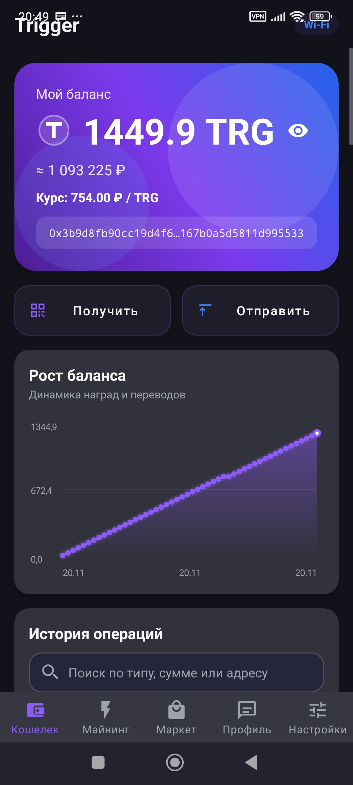
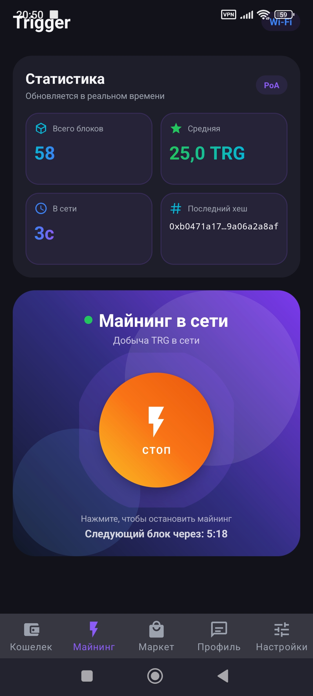
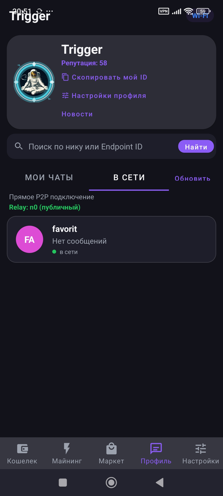

# ⚡ Trigger — P2P Блокчейн-Кошелек и Мессенджер

**Trigger** — это децентрализованное приложение для Android, работающее **без серверов**. Мы объединили P2P-сеть (Iroh), блокчейн-технологии и автоматический поиск пиров через DHT.

## 🌟 Возможности
*   📡 **Глобальный P2P-Радар:** Автоматический поиск пользователей через DHT/Gossip.
*   💬 **Приватные чаты:** Прямой обмен сообщениями (Peer-to-Peer).
*   💼 **Встроенный Кошелек:** Управление балансом TRG и криптографическими ключами.
*   ⛏️ **Майнинг:** Добыча токенов прямо на телефоне (PoA).
*   🛡️ **Безопасность:** Ваши ключи хранятся только на устройстве.

## 📸 Скриншоты

| Кошелек | Майнинг | В сети |
|:---:|:---:|:---:|
|  |  |  |

## 🚀 Установка

1.  Перейдите в раздел **[Releases](https://github.com/trigerjl/Trigger-/releases)**.
2.  Скачайте последний `.apk` файл.
3.  Установите его на ваш Android-смартфон (Android 8.0+).
4.  Запустите приложение и дайте доступ к сети.

## 🛠️ Технологии
*   **Android:** Java/Kotlin (UI, БД).
*   **Native:** Rust, Iroh (P2P, QUIC), DHT (Gossip).
*   **Сборка:** GitHub Actions (кросс-компиляция под ARM).

## 📄 Лицензия
MIT License.
